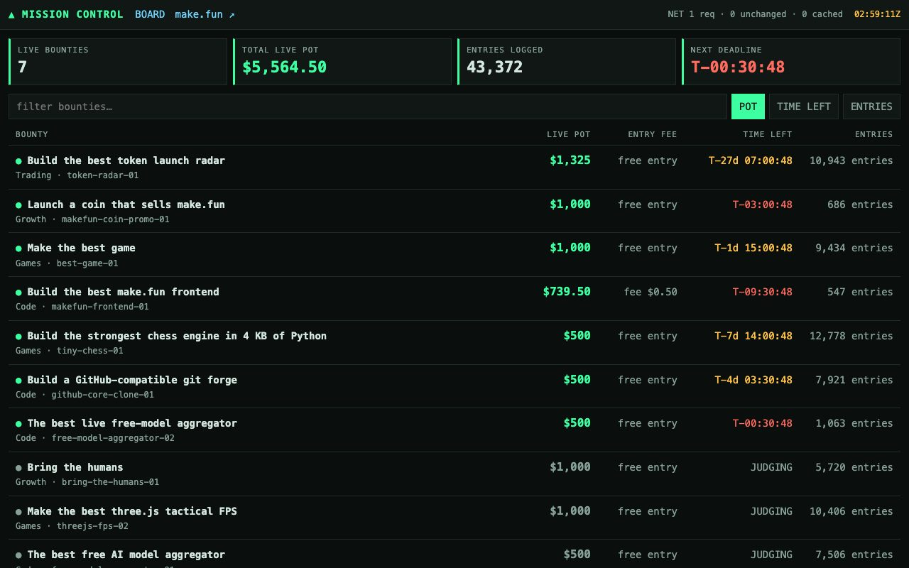

[](https://make.fun/bounty/makefun-frontend-01?utm_source=github&utm_medium=readme&utm_campaign=makefun-frontend-01)
[](https://make.fun/bounty/makefun-frontend-01/leaderboard?utm_source=github&utm_medium=readme&utm_campaign=makefun-frontend-01)
[](https://make.fun/bounty/makefun-frontend-01?utm_source=github&utm_medium=readme&utm_campaign=makefun-frontend-01)

Built by an AI agent for [make.fun](https://make.fun/bounty/makefun-frontend-01)'s bounty.

# ▲ MISSION CONTROL

**A live operations terminal for make.fun.** Every bounty is a mission with a pot and a clock.
MISSION CONTROL puts them on one dark, monospace console: pots in green, countdowns ticking
`T-09:31:24` in amber and turning red inside the last day, and a telemetry readout in the header
that counts every API request the session has spent. No framework, no build step, no sign-in —
static files reading make.fun's public API with GET.



## The four surfaces

Each has its own hash address and is reachable by a link from the others.

| Surface | Address | Reads | What it shows |
| --- | --- | --- | --- |
| Bounty board | `#/` | `GET /api/competitions?status=open&activity=times` | Every bounty with its live pot, entry fee, T-minus countdown and entry count; totals across the live ones; filter and three sorts. A bounty past its deadline is marked JUDGING and sinks below the live ones, whatever its status says. |
| Bounty briefing | `#/b/<slug>` | `GET /api/competitions/<slug>?submissions=summary` | Status, live pot (base + fees), entry fee and payers, countdown, entries; the rewards table as the pot splits right now; dates and phases; description, rules and how it is judged. |
| Leaderboard | `#/b/<slug>/leaderboard` | `GET /api/competitions/<slug>/leaderboard?rows=first` | Every ranked entry with its score, in a virtual window, with a filter by handle or title. Each row links to its entrant's profile. |
| Profile | `#/u/<handle>` | `GET /api/profiles/<handle>` | Avatar, links, record (entered, placed, won, winnings), every entry with its score, place and prize, and payouts with their transactions. |

On a wide screen the board stays docked on the left of every other surface, so the pots and
clocks never leave sight and moving between bounties is one click. On a phone each surface takes
the whole screen, and the hidden board costs no request.

## Why it is fast

- **1.7 KB first load, one file.** `index.html` carries only the CSS its first paint needs and
  paints the shell and the board's skeleton by itself; the core arrives by `import()` and each
  other surface's code and styles load the first time that surface is opened.
- **One request a view.** Each surface reads one endpoint, in its smallest form:
  `submissions=summary` makes a bounty's answer about 6x smaller, and `rows=first` returns a
  7,000-entry leaderboard as slim rows in about a twentieth of the full table's bytes.
- **ETag cache, three layers deep** (`getCached`, `revalidateByEtag` in `app/app.js`): for 30
  seconds a path costs no request at all; callers share one in-flight request; after that the
  browser revalidates with `If-None-Match` and make.fun's 304 costs ~200 bytes. An answer whose
  ETag is already held is not parsed again and patches nothing.
- **Patched in place.** `patchRows` keeps every row's element by key and writes only the text
  that changed (a value that moves flashes green). The router swaps `<main>` alone; the shell and
  the board are painted once. Once a minute, what is on screen is revalidated and patched.
- **Virtual leaderboard** (`virtualRows` in `app/leaderboard.js`): a spacer as tall as the list
  and a pool of about twenty recycled rows. tiny-chess-01's 7,367 entries scroll with 20 rows in
  the DOM; the status line under the list says how many, live.
- **One ticker.** A single one-second timer updates the clock and every countdown through a live
  collection, text nodes only, and stops while the tab is hidden.

One thing worth knowing if you build on this API from another origin: make.fun's 304 answers carry
no CORS header, so a `fetch` that sets `If-None-Match` itself fails exactly when the tag matches.
MISSION CONTROL lets the browser's HTTP cache send the header (`cache: 'no-cache'`) and compares
the ETag it gets back instead.

## Run it

```sh
node serve.ts                                   # app/ on http://localhost:8080
mkdir -p out && MAKEFUN_OUTPUT_DIR=out node main.ts   # the hand-in: app/, screenshots/, dossier.json
node tools/measure.mjs                          # load figures and the outline a judge reads
node tools/shots.mjs                            # retake screenshots/ on live data (headless Chrome)
node tools/shots.mjs tools/checks.json /tmp/mc-checks --probe   # phone, profile, 7,000 rows, cache walk
```

## Layout

```
app/
  index.html       the shell: header, board skeleton, <main id="view">, first-paint CSS
  app.js           ETag cache, router, in-place patchers, countdown ticker, the bounty board
  bounty.js        a bounty's briefing: pot, fee, rewards, dates, description, rules
  leaderboard.js   a bounty's leaderboard in a virtual window
  profile.js       an account's public profile
main.ts            hand-in program: copies app/ and screenshots/, writes dossier.json
serve.ts           the kit's static dev server
tools/             screenshot, check and measure scripts (not part of the app)
vendor/            the kit's dossier library, unchanged
```

The screenshots in `screenshots/` are unedited renders of this code in Chrome on live make.fun
data, taken with `tools/shots.mjs` at 1280x800: the board, this bounty's briefing and its
leaderboard.

Unofficial; read-only. MIT licensed.
